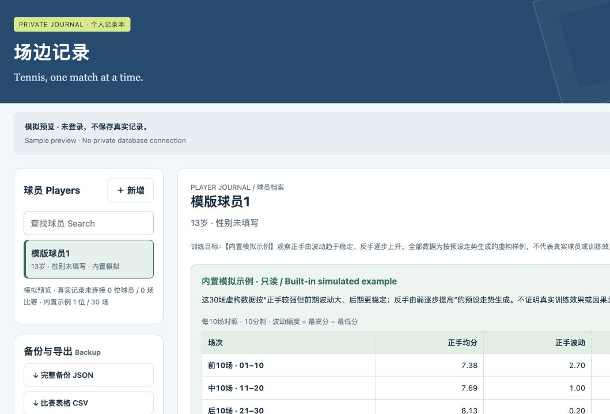
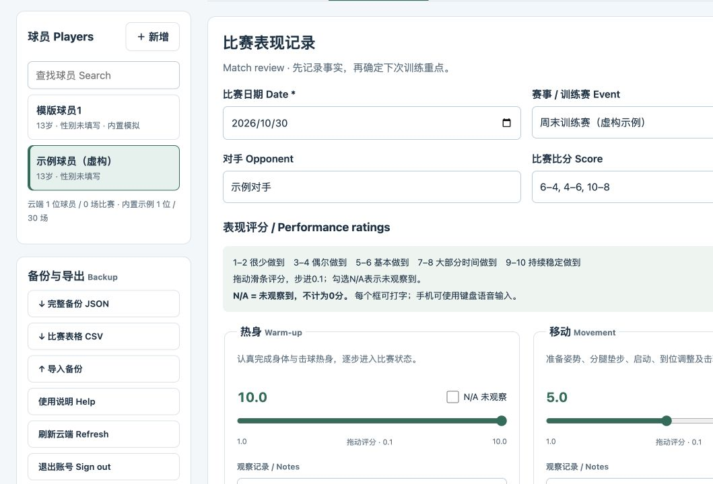

# 场边记录 · Courtside Tennis Journal

一个面向青少年网球训练的比赛记录工具，帮助教练记录球员表现，并回顾不同场次的变化。支持手机、iPad 和电脑浏览器。

## 在线体验（无需下载）

### [立即打开场边记录 / Try online](https://yytang-sz.github.io/courtside-tennis-journal/)

打开后点击「查看30场模拟示例」，即可浏览历史记录、区间数据与趋势图。**无需下载、安装 Python 或登录 GitHub。** 在线公开版为只读模拟演示，真实数据保存需接入自己的云环境。

| 数据回顾 / Dashboard | 比赛评分记录 / Match recording |
| --- | --- |
| <a href="docs/preview.png"></a> | <a href="docs/recording.png"></a> |

点击小图查看原图。图片中的球员和记录均为虚构示例。 / Click a thumbnail to enlarge. All illustrated records are fictional.

## 主要功能

- **球员档案**：姓名、年龄、性别与训练目标。
- **比赛评分**：12 个分项，1–10 分、步进 0.1，可选 N/A；每项均可记录文字，支持设备键盘语音输入。
- **技术评估**：正手、反手、发球、接发球与连续对打分别评分。
- **历史看板**：类似 Excel 的比赛明细，点击记录查看完整评分和备注。
- **数据回顾**：按最近场数查看区间均值、最低值、最高值与趋势；点击指标切换单项线图。
- **备份与云端**：JSON 备份/导入、CSV 导出；可接入腾讯云 CloudBase，以同一账号跨设备读取。

整体评分为有效分项的平均值，**排除 N/A 和独立的 0–10 分观察评分**。

## 可选：本地运行

仅需要在线体验时，直接使用上方链接即可。需要本地运行或修改源码时，请先安装 Python 3，下载仓库 ZIP 并解压，在包含 `site/` 文件夹的项目目录打开终端，再运行：

```bash
python3 -m http.server 8080 --directory site
```

保持终端运行，打开 <http://localhost:8080>，点击「查看30场模拟示例」。`localhost` 只代表运行这个命令的设备，并不是可分享的在线链接。请通过 HTTP/HTTPS 打开，直接双击 HTML 不适用于此云端版本。

默认云端配置为空，仅提供只读示例。**真实记录保存需要部署自己的云环境**，步骤见 [部署说明](docs/deployment.md)。本仓库不连接作者的私人数据库，不包含账号密码、密钥或真实球员记录。

内置「模版球员1」的 30 场数据按预设走势模拟生成，用于演示正手逐渐稳定、反手评分上升，不能证明真实训练效果。

## 开发与测试

技术栈：HTML / CSS / JavaScript、腾讯云 CloudBase JS SDK、Node.js 云函数与文档型数据库。

```bash
pnpm install --frozen-lockfile
pnpm test
# 可选：重新打包浏览器 SDK
pnpm run build:sdk
```

`site/` 已包含浏览器 SDK，可直接用于本地预览。云服务额度、费用及域名规则以服务商为准；不承诺永久免费托管或所有网络均可访问。

## English

Courtside Tennis Journal helps coaches record junior tennis matches and review player development. It includes player profiles, twelve 1–10 rating sliders with 0.1 increments and N/A, per-category notes, a clickable match ledger, recent-match summaries, metric-specific trend charts, and JSON/CSV exports.

The overall score averages valid component ratings, excluding N/A and the separate observer rating. The thirty built-in matches are synthetic illustrations, not evidence of training effectiveness.

Try the [online demo](https://yytang-sz.github.io/courtside-tennis-journal/) without downloading files, installing Python or signing in to GitHub. Select “Preview sample” to explore the thirty read-only synthetic matches. The screenshots above show the dashboard and match-recording interface; click either thumbnail to enlarge it.

Local setup is optional. Follow the [deployment guide](docs/deployment.md) to connect your own private Tencent CloudBase backend for real records. This repository contains no private player records or production credentials.
